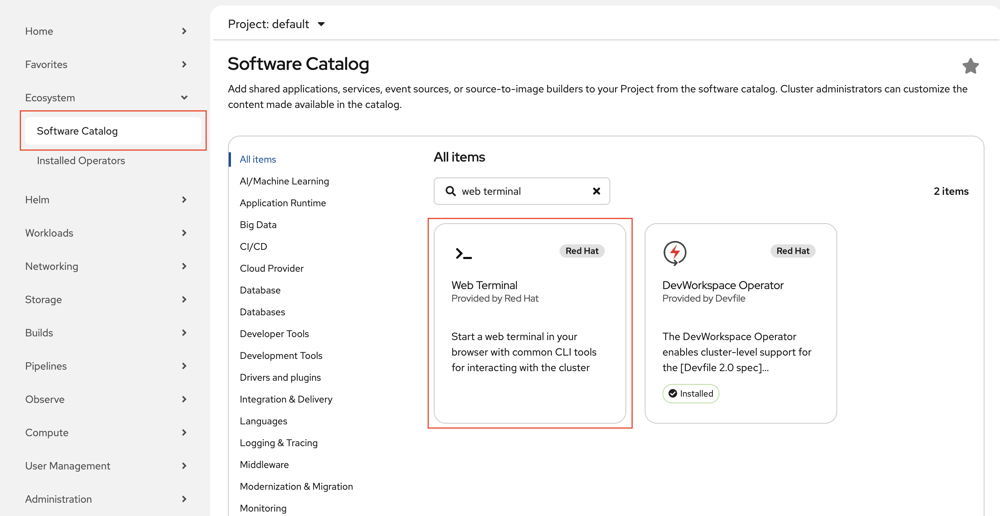
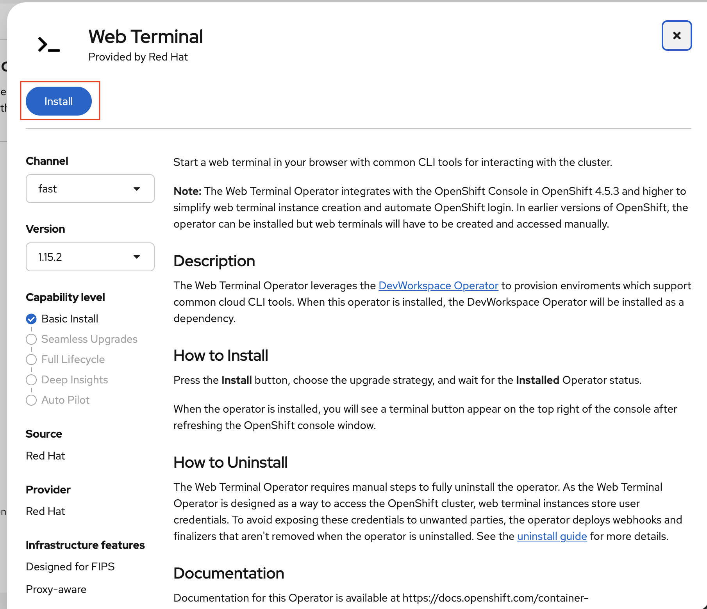
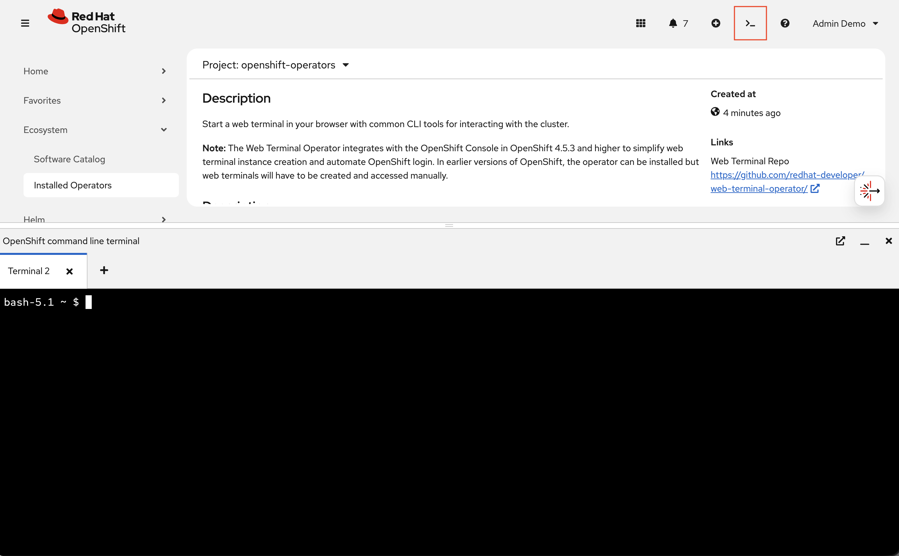

# Workshop Environment Setup

Created: 04 Nov 2026

Quick setup guide for workshop participants on a **Field Source** cluster. Follow these steps to prepare your cluster environment before the workshop begins.

---

## Step 1: Log in

Use the credentials provided by your workshop instructor. Log in to the OpenShift console and verify you can access the cluster.

## Step 2: Install Web Terminal

From the OpenShift console:

1. Go to **Ecosystem** > **Software Catalog**
2. Search for **Web Terminal**



3. Install it with default settings



4. Once installed, click the **>_** icon in the top-right of the console to open a terminal session



The Web Terminal is pre-configured with `oc` already authenticated. All commands below should be run from this terminal.

## Step 3: Enable all features

Run the following command in the Web Terminal:

```bash
curl -sL https://raw.githubusercontent.com/jingggg-wenn/rhoai-field-source-setup-guide/main/scripts/field-source-enable-all-features-35.sh | bash
```

This script installs the supporting operators (NFD, NVIDIA GPU Operator, cert-manager, LWS, OpenTelemetry, Tempo, Cluster Observability, Dev Spaces, RHCL), enables all RHOAI 3.5 components, and configures the dashboard. It takes several minutes to complete. See the header of [`field-source-enable-all-features-35.sh`](field-source-enable-all-features-35.sh) for the full list of changes.

> **Note:** The RHCL/Service Mesh installation (Step 9 of the script) may briefly disconnect your Web Terminal session. If this happens, operators continue installing in the background. Reconnect and re-run the same command -- completed steps are automatically skipped.

## Step 4: Set up MaaS

After Step 3 completes, run:

```bash
curl -sL https://raw.githubusercontent.com/jingggg-wenn/rhoai-field-source-setup-guide/main/scripts/field-source-setup-maas-35.sh | bash
```

This configures the Models-as-a-Service infrastructure (database, authentication, rate limiting, and gateway). See the header of [`field-source-setup-maas-35.sh`](field-source-setup-maas-35.sh) for details.

## Done

Once both scripts complete, your environment is ready. The RHOAI Dashboard URL is printed at the end of each script.

> **Instructors:** To create per-user Workbenches and Showroom lab guides for participants, see [`workshop-prep/README.md`](workshop-prep/README.md).
