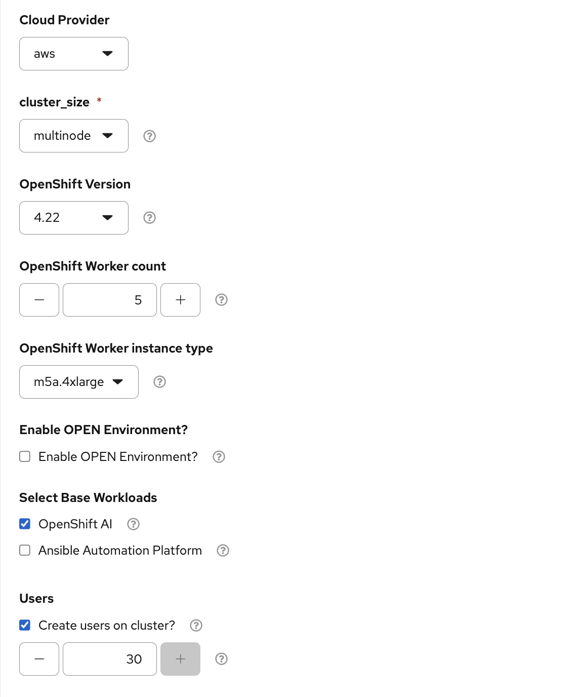
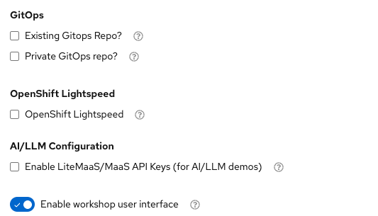

# Workshop Preparation Scripts (Administrators)

Created: 2026-11-04
Last modified: 2026-11-13

Scripts that prepare a Field Source OpenShift AI (RHOAI 3.5) cluster for a
hands-on workshop. Each participant gets their own **Workbench** and **Showroom**
(lab guide), and both live in one OpenShift AI project named after the user's
Keycloak username (`user1`, `user2`, ...).

> **Run these scripts from your own terminal, already logged in to the cluster.**
> Log in with `oc login` as a cluster-admin before you start; the scripts do not
> log in for you and stop if `oc` is not logged in. Do not use the OpenShift Web
> Terminal: the optional `spin-up-workernodes.sh` can wait up to 15 minutes, and
> `deploy-showroom.sh` changes the cluster's ingress settings, either of which can
> end a Web Terminal session part-way through.

## Step 0: Order the environment

Order the Field Source base environment from the
[Red Hat Demo Platform (RHDP)](https://demo.redhat.com) with these settings: **Field Sourced Content - OpenShift (Shared Clusters)**



| Field                          | Value                                                           | Notes                                                                       |
| ------------------------------ | --------------------------------------------------------------- | --------------------------------------------------------------------------- |
| Cloud Provider                 | `aws`                                                           |                                                                             |
| cluster_size                   | `multinode`                                                     | Not SNO. The workshop scripts expect worker MachineSets.                    |
| OpenShift Version              | `4.22`                                                          |                                                                             |
| OpenShift Worker count         | `5`                                                             | Size this for your user count. See [Sizing](#sizing-how-many-worker-nodes). |
| OpenShift Worker instance type | `m5a.4xlarge`                                                   | 16 vCPU, 64 GiB. The sizing guide assumes this type.                        |
| Enable OPEN Environment?       | unchecked                                                       |                                                                             |
| Select Base Workloads          | **OpenShift AI** checked; Ansible Automation Platform unchecked |                                                                             |
| Create users on cluster?       | checked, `30`                                                   | Creates `user1`..`user30` in Keycloak. 30 is the maximum for this env.      |

Then enable the workshop user interface (leave GitOps, Lightspeed, and LiteMaaS
unchecked unless you need them):



| Field                          | Value                                                           | Notes                                                                       |
| ------------------------------ | --------------------------------------------------------------- | --------------------------------------------------------------------------- |
| Enable workshop user interface | on                                                              | Turns on the RHDP workshop UI for participants.                             |
| Registration                   | `open`                                                          | Leave as open so participants can self-register.                            |

Set the worker count here, when you order. That is simpler than adding nodes
later. If you ordered fewer workers than the [sizing table](#sizing-how-many-worker-nodes)
recommends, use the optional step 2 to add more.

When the environment is ready, run the workshop prep scripts below, in order.

## Run order

Run the scripts in this order, from this folder (`cd scripts/workshop-prep`).
Step 2 is optional.

| Step | Script | What it does | Arguments to set | Time |
| ---- | ------ | ------------ | ---------------- | ---- |
| 1 | [`setup_workshop_users_rbac.sh`](setup_workshop_users_rbac.sh) | Grants each Keycloak user `cluster-admin` and adds them to `rhods-admins` | None | Seconds |
| 2 *(optional)* | [`spin-up-workernodes.sh`](spin-up-workernodes.sh) | Adds worker nodes. Only needed if you ordered fewer workers than the [sizing table](#sizing-how-many-worker-nodes) recommends. | `--users <n>`; preview first with `--dry-run` | 5–15 min |
| 3 | [`gpu_machineset_hardwareprofiles.sh`](gpu_machineset_hardwareprofiles.sh) | Creates a GPU MachineSet (0 nodes) and the `gpu-profile` HardwareProfile that participants select to deploy models on a GPU | None. Then scale the GPU MachineSet up (see [step 3](#step-3-gpu_machineset_hardwareprofilessh)) | 1 min, plus 15–20 min per GPU node |
| 4 | [`setup_workbench_by_users.sh`](setup_workbench_by_users.sh) | Creates a project, PVC, and Jupyter Workbench for each user and configures EvalHub tenants | Optional: `WORKSHOP_USERS`, `WORKBENCH_SIZE` | 1–2 min, plus tenant verification |
| 5 | [`deploy-showroom.sh`](deploy-showroom.sh) | Deploys a Showroom lab guide per user, with Workbench, Console, and Dashboard tabs | **Required:** `WORKSHOPS`. Recommended: `SITE_TITLE`, `HOME_INDEX_FILE` | 5–10 min |

Why this order:

- **Infrastructure before users (steps 2 and 3).** Nodes are the slowest part.
If you use step 2, run it before the Workbenches: Workbench pods start as soon
as they are created, and if the new nodes are not Ready yet, the first
Workbenches crowd the existing workers and stay there.
`spin-up-workernodes.sh` waits until the new nodes are Ready.
- **GPU setup (step 3) before the Workbenches.** A new GPU node takes 15–20
minutes to become usable (EC2 boot, then the GPU Operator installs the driver).
Creating and scaling it here lets it come up while steps 4 and 5 run. The
`gpu-profile` HardwareProfile must exist before participants deploy models.
- **EvalHub tenants after project creation (step 4).** Tenant RBAC is applied
automatically after the Workbench creation loop and before URL lookup. Deploy the shared EvalHub first with
`field-source-enable-all-features-35.sh`; tenant setup requires existing projects
and the TrustyAI ClusterRoles. Workbench pods do not need to be Running yet.
- **Step 5 last.** `deploy-showroom.sh` adds a Workbench tab only when it finds
a Workbench in the user's project.

All scripts are idempotent. Re-run any of them to add users or pick up changes.

To target specific users instead of everyone in Keycloak, export the **same**
list before running steps 4 and 5. If you use step 2, pass the matching count:

```bash
export WORKSHOP_USERS="user1,user2,user3,user4"
bash spin-up-workernodes.sh --users 4
```

## Prerequisites

- A terminal on your own machine (macOS or Linux), with the `oc` CLI installed
- Already logged in to the cluster as a cluster-admin. Check with `oc whoami`
(it should print your admin user) and `oc whoami --show-server` (it should
print this cluster's API URL).
- RHOAI 3.5 installed with the workbenches component ready
- Shared EvalHub and MLflow deployed with `field-source-enable-all-features-35.sh`
before step 4, which configures EvalHub tenants by default
- Workshop users already provisioned in Keycloak (a `KeycloakRealmImport` CR named
`sso` in the `keycloak` namespace). Step 1 requires this. Steps 2, 4, and 5 can
instead take a user count or an explicit list (`--users`, `WORKSHOP_USERS`).
- For GPU nodes (step 3): the NVIDIA GPU Operator and Node Feature Discovery
installed. The Field Source base environment does not include them;
`field-source-enable-all-features-35.sh` installs both.
- `bash`, `curl`, `python3` (step 3), and `sha256sum` or `shasum` (all present
on macOS and most Linux distributions)

## Sizing: how many worker nodes

Use this table to choose **OpenShift Worker count** when you order (step 0).
The counts are total workers, including the ones that run the RHOAI platform.

| Users | Workbenches reserve | Workers to order | If already running, add with |
| ----- | ------------------- | ---------------- | ---------------------------- |
| 10 | 10 CPU, 40 GiB | **3** | `bash spin-up-workernodes.sh --users 10` |
| 20 | 20 CPU, 80 GiB | **4** | `bash spin-up-workernodes.sh --users 20` |
| 30 | 30 CPU, 120 GiB | **6** | `bash spin-up-workernodes.sh --users 30` |

Each `m5a.4xlarge` costs about $0.69/hour on demand in us-east.

> **5 workers for 30 users** (the step 0 example) fits about 28 users by this
> estimate. That is usually fine, but it leaves little headroom. Order 6, or
> run `bash spin-up-workernodes.sh --users 30` after provisioning to add one more.

How the numbers are worked out:

```
total workers = 1 (platform) + ceil(users / 7)
```

- **Per user**, plan for about 2 CPU and 8 GiB requested: the Small Workbench
(1 CPU / 4 GiB), the Showroom (about 0.1 CPU / 0.25 GiB), and headroom for
what the labs deploy (agents, EvalHub jobs).
- **One** `m5a.4xlarge` has about 15.5 CPU and 58 GiB usable, which fits about
**7 users**.
- **One worker's worth** is reserved for the platform pods that already run on
the base workers (operators, MLflow, EvalHub, monitoring, Dev Spaces).

Adjust when your workshop differs:

| Situation | What to do |
| --------- | ---------- |
| Other user counts | `--users <n>` applies the same formula (for example, 15 users gives 4 workers) |
| Workers already more than 50% reserved before step 4 (`spin-up-workernodes.sh --dry-run` prints this) | Add one more: `--workers <recommended + 1>` |
| `WORKBENCH_SIZE=Medium` (2 CPU / 8 GiB per Workbench) | `USERS_PER_WORKER=4 bash spin-up-workernodes.sh --users <n>` |
| You want an exact node count | `--workers <n>` (total workers, not extra) |

These counts are for CPU workers only. GPU nodes for model serving are added
separately in [step 3](#step-3-gpu_machineset_hardwareprofilessh).

---

## Step 1: `setup_workshop_users_rbac.sh`

Gives every workshop user the permissions they need for the labs.

```bash
bash setup_workshop_users_rbac.sh
```

It:

1. Reads the users from the `KeycloakRealmImport` CR `sso` in the `keycloak` namespace
2. Creates a `cluster-admin-<username>` ClusterRoleBinding for each user
3. Adds each user to the `rhods-admins` group (creating the group if needed),

   which gives them admin access in the RHOAI dashboard

This script has no options. It always applies to **every** user in the
KeycloakRealmImport, including `admin`, and ignores `WORKSHOP_USERS`. If Keycloak
is not available, it exits with an error.

> **Note:** `field-source-setup-maas-35.sh` does not add users to `rhods-admins`.
> It relies on this script for that.

---

## Step 2 (optional): `spin-up-workernodes.sh`

Skip this step if you ordered the worker count from the
[sizing table](#sizing-how-many-worker-nodes). Use it when the cluster has too
few workers, for example after adding users. Run with `--dry-run` first: it
shows the current workers and how busy they are, without changing anything.

Adds worker nodes by scaling the cluster's **existing** worker MachineSets. Each
new node goes to the MachineSet with the fewest replicas, so nodes spread across
availability zones. GPU MachineSets are skipped.

```bash
bash spin-up-workernodes.sh --users 30 --dry-run   # show the plan only
bash spin-up-workernodes.sh --users 30             # scale and wait for Ready
```

It:

1. Lists the worker MachineSets and their current replica counts
2. Works out the target from `--users` (or the Keycloak user count) or `--workers`
3. Prints how much CPU and memory the current workers already have reserved
4. Scales MachineSets up to the target. It never scales down.
5. Waits up to 15 minutes for the new nodes to be Ready, then prints the

   commands to scale back after the workshop

The script counts the workers you already have. For example, with 5 workers
already running, `--users 30` adds 1 (target 6). With 6 or more, it makes no change.

### Options

| Argument / variable | Default                             | Description                                    |
| ------------------- | ----------------------------------- | ---------------------------------------------- |
| `--users <n>`       | Keycloak user count (minus `admin`) | Number of participants to size for             |
| `--workers <n>`     | *(from* `--users`*)*                | Exact total worker count; overrides `--users`  |
| `--dry-run`         | off                                 | Show the plan without scaling                  |
| `--no-wait`         | off                                 | Scale and exit without waiting for nodes       |
| `USERS_PER_WORKER`  | `7`                                 | Users per added worker node                    |
| `PLATFORM_WORKERS`  | `1`                                 | Workers' worth reserved for the RHOAI platform |
| `WAIT_TIMEOUT`      | `900`                               | Seconds to wait for nodes to be Ready          |

If nodes are not Ready after 15 minutes, check `oc get machines -n openshift-machine-api`
for `Failed` machines. The usual cause is an AWS capacity or quota limit for
`m5a.4xlarge` in that zone.

---

## Step 3: `gpu_machineset_hardwareprofiles.sh`

Sets up GPU capacity for the model-serving labs. Run it once; it takes no
arguments.

```bash
bash gpu_machineset_hardwareprofiles.sh
```

It:

1. Creates a GPU MachineSet named `<infra-id>-worker-gpu-<az>` with **0 nodes**.
   Each node is a `g6.2xlarge` (1 NVIDIA L4 GPU with 24 GB, 8 vCPU, 32 GiB),
   in the same zone and subnet as an existing worker. GPU nodes are tainted
   (`nvidia.com/gpu=True:NoSchedule`), so only GPU workloads run on them.
2. Creates the `gpu-profile (L4)` HardwareProfile in `redhat-ods-applications`,
   or fixes it if it already exists. Participants select it when deploying a
   model. It allows 1–8 CPU, 1–16 GiB memory, and 1–4 GPUs, and targets nodes
   labelled `nvidia.com/gpu.present=true` with the matching toleration.

The script does not start any GPU nodes. Scale the MachineSet up yourself:

```bash
oc get machinesets -n openshift-machine-api | grep gpu        # find the name
oc scale machineset <infra-id>-worker-gpu-<az> -n openshift-machine-api --replicas=<n>
oc get machines -n openshift-machine-api -w                    # wait for Running
oc get nodes -l nvidia.com/gpu.present=true                    # GPU usable when listed
```

How many GPU nodes: one per model that runs at the same time. One L4 fits one
small LLM (about 7–8B parameters). Each `g6.2xlarge` costs about $0.98/hour on
demand in us-east.

A new node appears in `oc get nodes` after about 5–10 minutes, but is only
usable for GPU workloads once the GPU Operator has installed the driver and
added the `nvidia.com/gpu.present=true` label, usually 15–20 minutes in total.
If the node joins but never gets that label, check that the GPU Operator is
installed (see [Prerequisites](#prerequisites)).

The script is idempotent. `spin-up-workernodes.sh` ignores the GPU MachineSet.

---

## Step 4: `setup_workbench_by_users.sh`

Creates one OpenShift AI Workbench per participant, using the
**Jupyter | Data Science | CPU | Python 3.12** image.

```bash
# Auto-discover users from Keycloak (skips admin)
bash setup_workbench_by_users.sh

# Or give an explicit list
export WORKSHOP_USERS="user1,user2,user3,user4"
bash setup_workbench_by_users.sh
```

For each user it:

1. Creates the OpenShift AI project `<username>` (visible in the dashboard)
2. Grants the user `admin` on that project
3. Creates a `20Gi` PVC for notebook storage
4. Creates a `Notebook` CR named `my-workbench`, using `inject-auth` on

   Gateway-based clusters and `inject-oauth` on legacy clusters
5. Prints each Workbench URL

Existing Workbenches are left unchanged. To change the size or image of an
existing one, delete it (`oc delete notebook my-workbench -n <user>`) and re-run.

### EvalHub tenant setup

Deploy EvalHub and MLflow first using `field-source-enable-all-features-35.sh`.
The regular `bash setup_workbench_by_users.sh` command configures EvalHub tenants
automatically after the Workbench creation loop and before URL lookup.
It uses only users whose project, PVC, and Notebook were provisioned successfully,
including existing Workbenches. It never discovers users a second time, so the
Workbench selection and `SKIP_ADMIN` discovery filter are preserved. If no users
were provisioned successfully, tenant setup is skipped and the command fails.

For each selected project it applies seven RoleBindings, two Roles, a job
ServiceAccount, and the dedicated `evalhub-service-ca` ConfigMap. The central
EvalHub ServiceAccount receives access to all Secrets in the project, including
create, update, patch, and delete; the job ServiceAccount receives namespace
`edit` access, MLflow access, and `status-events/create` permission to report
progress and completion. Notebook and PVC specifications, MLflow workspace
configuration, and artifact storage settings are not changed by the tenant stage.

Before applying tenant resources, it checks the shared EvalHub ServiceAccount and
all four required TrustyAI ClusterRoles. It then verifies both ServiceAccounts'
permissions, including MLflow and status-event authorization through SubjectAccessReviews, and
waits up to 10 seconds per project for the service CA bundle. An empty CA bundle
is a failure. This verifies RBAC and CA injection; run the lab's setup notebook to
confirm EvalHub and MLflow work end to end.

If EvalHub cached a failed MLflow workspace probe at startup, the script waits for
MLflow, checks its server-info API, and replaces the EvalHub API Pod once to refresh
the probe. Direct Pod replacement avoids the Operator reverting Deployment restart
annotations.
Healthy EvalHub instances are left running. The default EvalHub SQLite database
is in memory, so re-register custom providers in the setup notebook after this
recovery restart. Tenant failures do not trigger a restart.

Tenant setup runs in a separate subshell, with no helper file or download needed,
so the regular `curl | bash` command also configures EvalHub tenants. On any
Workbench or tenant error, the script prints the available Workbench URLs and summary before
returning a nonzero exit status. Tenant failures are reported separately from
Workbench creation failures. Resources already applied are retained; correct the
error and rerun the same command. Set `ENABLE_EVALHUB_TENANTS=false` only when
intentionally skipping tenant setup; then no EvalHub resources are read or applied.

### Options

| Variable | Default | Description |
| -------- | ------- | ----------- |
| `WORKSHOP_USERS` | *(auto)* | Comma-separated users; if unset, discovered from Keycloak |
| `SKIP_ADMIN` | `admin` | Comma-separated usernames to skip during discovery |
| `KC_NAMESPACE` | `keycloak` | Keycloak namespace |
| `KC_REALM_IMPORT_NAME` | `sso` | `KeycloakRealmImport` CR name |
| `WORKBENCH_NAME` | `my-workbench` | Notebook name |
| `WORKBENCH_SIZE` | `Small` | `Tiny` / `Small` / `Medium` / `Large` (affects [sizing](#sizing-how-many-worker-nodes)) |
| `PVC_SIZE` | `20Gi` | Workbench storage size |
| `STORAGE_CLASS` | *(cluster default)* | PVC StorageClass override |
| `IMAGE_STREAM` | *(auto)* | ImageStream name in `redhat-ods-applications` |
| `IMAGE_TAG` | *(auto)* | ImageStream tag |
| `ENABLE_EVALHUB_TENANTS` | `true` | Configures and verifies EvalHub tenants after Workbench provisioning; set to `false` to skip |
| `EVALHUB_NS` | `redhat-ods-applications` | Shared EvalHub namespace, used only when tenant setup is enabled |

### Check the result

A printed URL does not mean the Workbench is running. Before the workshop, check:

```bash
oc get notebooks -A
oc get pods -A -l notebook-name=my-workbench    # all should be Running, none Pending
```

Workbench URLs look like this:

```
# Gateway-based clusters
https://<data-science-gateway-host>/notebook/<username>/my-workbench/

# Legacy clusters (per-workbench Route)
https://my-workbench-<username>.<cluster-domain>/notebook/<username>/my-workbench/
```

If the script warns that an existing Workbench is missing `inject-auth`, that
Workbench was created before the cluster moved to the AI Gateway. Follow the
[OpenShift AI authentication migration procedure](https://docs.redhat.com/en/documentation/red_hat_openshift_ai_self-managed/3.5/html/upgrading_openshift_ai_self-managed/post-upgrade-steps-for-openshift-ai_upgrade),
or delete and re-create the Workbench.

---

## Step 5: `deploy-showroom.sh`

Deploys one Showroom lab guide per participant into the same `<username>`
project as their Workbench. Each Showroom is personalized with the user's
username, password, and login command, and shows the Workbench, OpenShift Console,
and RHOAI Dashboard as tabs next to the lab content.

No Helm, image build, or extra application is needed. Everything runs from
ConfigMaps and the upstream `quay.io/rhpds` images. The pods download the lab
content from Git and the Showroom theme from GitHub when they start, so the
cluster needs internet access.

```bash
export SITE_TITLE="RHOAI Hands-on Workshop"
export WORKSHOPS="
basic-inference|https://github.com/jingggg-wenn/rhoai-basic-inference-workshop|main|content|Basic Inference
"
bash deploy-showroom.sh
```

If Keycloak is not available, also set `WORKSHOP_USERS` and `USER_PASSWORD`.
When `USER_PASSWORD` is unset, each user's own password is read from their
Keycloak entry.

### `WORKSHOPS` format

One workshop per line, pipe-delimited: `name|git_url|git_ref|content_path[|title]`

| Field | Required | Description |
| ----- | -------- | ----------- |
| `name` | yes | URL path and Antora component name (`a-z0-9` and hyphens) |
| `git_url` | yes | HTTPS Git URL (no credentials) |
| `git_ref` | yes | Branch or tag (commit SHAs are not supported) |
| `content_path` | yes | Directory containing `antora.yml` (for example `content`) |
| `title` | no | Name shown on the home page (defaults to `name`) |

Blank lines and lines starting with `#` are ignored.

### Options

| Variable | Default | Description |
| -------- | ------- | ----------- |
| `WORKSHOPS` | *(none)* | Workshop list (see format above). Required. |
| `SITE_TITLE` | `Workshop` | Title shown in the browser tab and on the home page |
| `WORKSHOP_USERS` | *(auto)* | Comma-separated users; if unset, discovered from Keycloak (`admin` skipped) |
| `USER_PASSWORD` | *(auto)* | One password for all users; otherwise each user's Keycloak password |
| `HOME_INDEX_FILE` | *(auto-generated)* | Custom home page `.adoc`, local path or `https://` URL. Used only with 2+ workshops. |
| `KC_NAMESPACE` | `keycloak` | Keycloak namespace |
| `KC_REALM_IMPORT_NAME` | `sso` | `KeycloakRealmImport` CR name |
| `MAX_PARALLEL` | `10` | Maximum rollouts waited on at once |
| `EXTRA_TABS` | *(none)* | Extra tabs, one per line: `name\|url\|external` |
| `SKIP_FRAME_PATCH` | *(off)* | Set to `true` to skip the ingress header changes for embedding |

### Custom home page

With more than one workshop, a home page listing them is generated for you. To
use your own, point `HOME_INDEX_FILE` at an AsciiDoc file. The sample
[`my-home.adoc`](my-home.adoc) in this folder is a starting point. Link to each
workshop with `xref:<name>::index.adoc[Title]`, where `<name>` matches the first
field of its `WORKSHOPS` line. With a single workshop there is no home page;
Showroom opens that workshop directly.

### Result

Each user gets a Showroom at:

```
https://showroom-showroom-<username>.<cluster-domain>
```

To refresh content after a Git change, re-run the script, or restart one user's pod:

```bash
oc rollout restart deployment/showroom -n user1
```

> **Note:** `deploy-showroom.sh` updates the default IngressController response
> headers so the Console and Dashboard can be embedded in Showroom. Only the
> Showroom origins from the current run are allowed, so always run it with the
> full participant list.

---

## Running without cloning the repo

None of the scripts need local files, so you can also run them straight from
GitHub with `curl | bash`. Run this in your own terminal, logged in to the
cluster, as above. Pass script arguments after `bash -s --`:

```bash
BASE=https://raw.githubusercontent.com/jingggg-wenn/rhoai-field-source-setup-guide/refs/heads/main/scripts/workshop-prep

# Step 1
curl -sL "$BASE/setup_workshop_users_rbac.sh" | bash

# Step 2 (optional)
curl -sL "$BASE/spin-up-workernodes.sh" | bash -s -- --users 30

# Step 3 (then scale the GPU MachineSet, see step 3 above)
curl -sL "$BASE/gpu_machineset_hardwareprofiles.sh" | bash

# Step 4
curl -sL "$BASE/setup_workbench_by_users.sh" | bash

# Step 5
export SITE_TITLE="RHOAI Hands-on Workshop"
export HOME_INDEX_FILE="$BASE/my-home.adoc"
export WORKSHOPS="
basic-inference|https://github.com/jingggg-wenn/rhoai-basic-inference-workshop|main|content|Basic Inference
agentops|https://github.com/hyogrin/rhoai-basic-agentops-workshop|main|content|AgentOps Workshop
evalhub|https://github.com/hyogrin/rhoai-basic-evalhub-workshop|main|content|Eval Hub Workshop
"
curl -sL "$BASE/deploy-showroom.sh" | bash
```

## Cleanup after the workshop

**If you used step 2 and are keeping the environment**, scale the workers back
to stop the extra EC2 charges. `spin-up-workernodes.sh` prints the exact
`oc scale machineset ...` commands, with the original replica counts, at the end
of its run. Do this after removing the Workbenches and Showrooms, so their pods
are not moved onto the remaining nodes. If you are deleting the whole RHDP
environment, skip this.

**Scale GPU nodes to 0** if you are keeping the environment. GPU nodes are the
most expensive part of the cluster:

```bash
oc scale machineset <infra-id>-worker-gpu-<az> -n openshift-machine-api --replicas=0
```

**Remove only the Showroom resources.** This keeps each user's project,
Workbench, and storage:

```bash
for ns in user1 user2 user3 user4; do
  oc delete deployment/showroom service/showroom route/showroom configmap/showroom-config \
    -n "$ns" --ignore-not-found
done
```

To remove everything for a user, including their Workbench data, delete the
project: `oc delete project user1`.

**Remove the permissions granted in step 1:**

```bash
for u in user1 user2 user3 user4; do
  oc delete clusterrolebinding "cluster-admin-$u" --ignore-not-found
  oc adm groups remove-users rhods-admins "$u"
done
```
